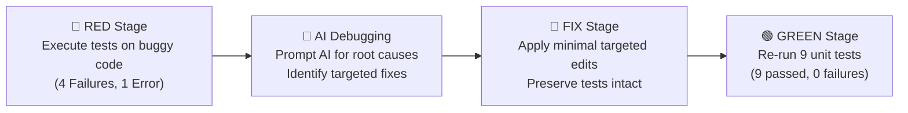

# Fixing a Buggy Python Script Using AI

A structured case study in test-driven bug fixing and AI-assisted code review based on **Lecture 8**.

- **Author**: Ayan Khan
- **Repository**: [https://github.com/ayankhanbebea-lgtm/bug-fixing-using-cursor-ai](https://github.com/ayankhanbebea-lgtm/bug-fixing-using-cursor-ai)

---

## 1. Overview of `student_utils.py`

`student_utils.py` provides utility functions for academic evaluation and student grading:

1. `calculate_average(marks)`: Calculates the arithmetic mean of a list of numeric marks.
2. `is_passing(mark)`: Evaluates whether a given score meets or exceeds the minimum passing standard (`PASS_MARK = 40`).
3. `get_grade(mark)`: Classifies a numeric mark into academic divisions:
   - Mark $\ge 90$: `"Distinction"`
   - Mark $\ge 60$: `"First"`
   - Mark $\ge 45$: `"Second"`
   - Mark $< 45$: `"Fail"`

---

## 2. Test Suite (`test_student_utils.py`)

The test suite consists of **EXACTLY 9 tests** written with Python's standard `unittest` framework:

1. `test_average_three_marks`: Verifies `calculate_average([80, 90, 100])` produces `90.0`.
2. `test_average_one_mark`: Verifies `calculate_average([40])` produces `40.0`.
3. `test_average_two_marks`: Verifies `calculate_average([50, 70])` produces `60.0`.
4. `test_pass_boundary`: Verifies exact passing boundary `is_passing(40)` returns `True`.
5. `test_fail_below_boundary`: Verifies score below boundary `is_passing(39)` returns `False`.
6. `test_pass_above_boundary`: Verifies score above boundary `is_passing(75)` returns `True`.
7. `test_grade_distinction`: Verifies `get_grade(95)` returns `"Distinction"`.
8. `test_grade_first`: Verifies `get_grade(65)` returns `"First"`.
9. `test_grade_second`: Verifies `get_grade(50)` returns `"Second"`.

---

## 3. How to Run the Tests

Execute the test suite using standard Python:

```bash
python test_student_utils.py
```

### Final Result:
All **9 tests pass**:

```text
.........
----------------------------------------------------------------------
Ran 9 tests in 0.000s

OK
```

---

## 4. The RED → FIX → GREEN Workflow

The project strictly follows the standard Test-Driven Development (TDD) and AI-assisted debugging cycle:



1. **🔴 RED Stage**:
   - The original `student_utils.py` contains 3 distinct defects.
   - Running `python test_student_utils.py` against the original buggy script reveals 4 test failures and 1 runtime error (`ZeroDivisionError`).
   - The raw failure output is logged in `evidence/red_test_output.txt`.

2. **🤖 AI Debugging & 🔧 FIX Stage**:
   - An AI assistant is prompted with individual failing test assertions to diagnose the root cause without blind rewriting.
   - Bug 1: Corrected denominator from `len(marks) - 1` to `len(marks)`.
   - Bug 2: Corrected boundary comparison from `mark > PASS_MARK` to `mark >= PASS_MARK`.
   - Bug 3: Corrected ordering so `mark >= 90` ("Distinction") is evaluated before `mark >= 60` ("First").

3. **🟢 GREEN Stage**:
   - The unchanged test suite is re-executed against the corrected code.
   - All 9 unit tests pass cleanly (`Ran 9 tests ... OK`).
   - The passing execution log is preserved in `evidence/green_test_output.txt`.

---

## 5. Repository Structure

```text
.
├── student_utils.py           # Corrected Python utility implementation
├── test_student_utils.py      # 9 unit tests verifying all functions & edge cases
├── bug_notes.md               # Detailed audit table & AI prompt transcripts
├── audit.md                   # Complete repository compliance audit
├── evidence/
│   ├── red_test_output.txt    # Captured output during the failing RED stage
│   └── green_test_output.txt  # Captured output during the passing GREEN stage
├── buggy_average.c            # Legacy reference files preserved from initial commit
├── buggy_average.py
├── fixed_average.c
├── fixed_average.py
└── README.md                  # Project overview and workflow documentation
```
